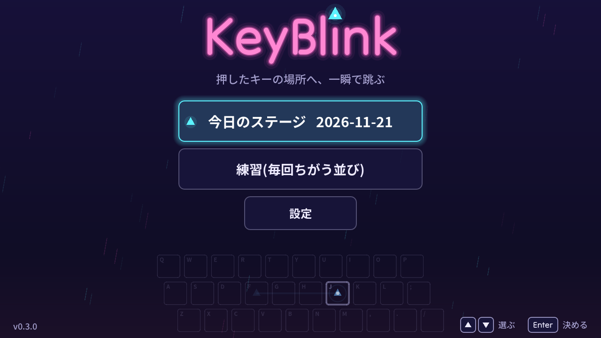
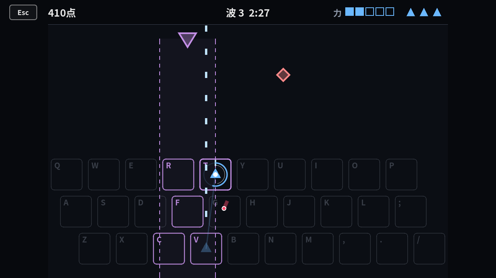
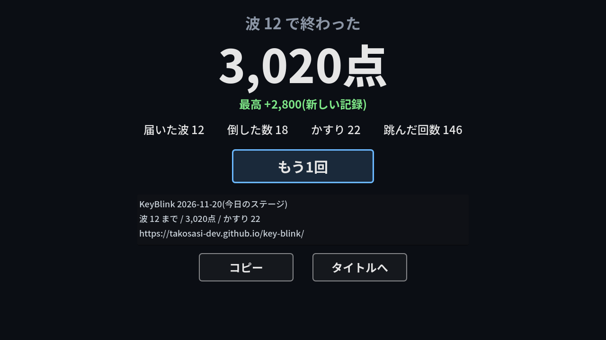

# KeyBlink

画面の下半分がキーボードの英字の 3 段(30 キー)になっていて、**押したキーの場所へ自機が一瞬で移る**縦のシューティングです。自機は上へ自動で撃ち続けます。動かずにいると力がたまって弾が強くなり、跳ぶと力が減ります。3 分のステージを残機 3 で生き残ります。ブラウザで開くだけで遊べます。

**▶ 遊ぶ: https://takosasi-dev.github.io/key-blink/** (デスクトップの Chrome・Edge・Firefox。キーボードで遊びます。インストール不要)

> v0.2.1。人に遊んでもらう確かめはまだです。ブラウザは窓なしの Chrome で、起動から一通りの流れまで確かめました。弾の速さなどの値は、テスト用の bot で決めた物です(下の「開発状況」)。







## 遊び方

- Q〜P・A〜;・Z〜/ の 30 キーが、画面の 30 の場所です。キーを押すと、自機がその場所へ一瞬で移ります。途中は通らないので、弾の間も壁も跳び越えられます。
- 跳んだ後 0.125 秒は跳べません。その間に押したキーは、最後の 1 つを覚えておいて、待ちが終わった時に跳びます。
- 自機は自動で真上へ撃ちます。敵の真下へ跳んで倒します。
- **動かずにいると力がたまり**(自機のまわりの輪)、弾が 1 → 2 → 3 段と強くなります。跳ぶと力が減ります。
- 当たりは自機の中心の白い点だけです。敵の弾をぎりぎりでかすめると点が入ります。
- 当たると残機が 1 減り、画面の弾と壁が消え、2 秒の間は当たりません。
- 敵が撃つ直前には、敵のまわりに縮む輪と、撃つ向きの短い線が出ます。柱の光線が当たるキーは枠が紫に、壁の隙間に入るキーは枠が緑になります。
- 15 秒の波が 12 個(3 分)。最後まで残ればクリアで、残機 1 つにつき 2,000 点。
- Esc で一時停止。

| 敵 | 形 | すること |
|---|---|---|
| 小物 | ひし形 | 自機へ向けて弾を撃つ |
| 扇 | 縁の太い円 | 自機の向きと ±15°・±30° の 5 方向に撃つ |
| 柱 | 下向きの三角 | 1 秒の点線の予告の後、縦の光線を出す。予告の間に列の外へ跳ぶ |
| 壁 | 横長の四角 | 隙間が 1 つある横の壁を落とす。隙間に入るか、通り過ぎた上の段へ跳ぶ |

キーは**位置**で取るので、JIS 配列でも US 配列でも、同じ位置のキーが同じ場所になります。

## 今日のステージ

「今日のステージ」は日付で決まり、同じ日なら誰でも同じ敵の並びです。結果画面の文字をコピーして貼れば比べられます。「練習」は毎回ちがう並びです。

```
KeyBlink 2026-11-19(今日のステージ・1回目)
クリア 残機 2 / 48,250点 / かすり 132
https://takosasi-dev.github.io/key-blink/
```

点 = 倒した敵(小物 100・扇 400・柱 300・壁 300)+ かすり 1 回 10 + クリアの時の残機 × 2,000。

## しくみ

- **ゲームの決まりは `core/` にだけ**あります(跳ぶ・力・撃つ・敵・弾・当たり・点数・波)。画面は `sim.snapshot()` と `sim.events()` を読んで描くだけです。
- 1/120 秒刻みで進め、入力はキーの番号(整数)だけを受けます。向きの回転は 360 の向きの表(`core/dirs.gd`、`tools/gen_dirs.py` が作る)で行い、`sin`・`cos` を呼びません。同じ種と同じ入力なら同じ結果になることを、テストで確かめています。
- 30 キーの配置の表は `core/keys.gd` の 1 か所にあります(姉妹作 KeySwat の表と同じ段のずれ)。
- テスト用の bot(弾を避ける bot・何もしない bot・敵の下にいる bot)を回して、遊びの値を確かめています。
- 保存はブラウザの中(localStorage の `key-blink/save`)だけです。サーバーとの通信やアクセス解析はありません。

## 動作環境

- Godot 4.7.2-stable(GDScript、レンダラー Compatibility)
- Web 書き出しはスレッド無し・拡張無し

## 開発

```
# テスト(全件成功で終了コード 0)
godot --headless --import
godot --headless --script res://tests/run_tests.gd

# Web 書き出し(書き出しテンプレート 4.7.2 が要る)
godot --headless --export-release "Web" build/web/index.html

# 窓なしで本体を動かし、S0 → 今日のステージ → 結果まで bot に通させる(Python)
python tools/gd.py smoke 7000 --auto=idle
python tools/gd.py smoke 13000 --auto=dodge

# bot 3 種の結果を種 1〜10 で出す
python tools/gd.py run res://tools/bot_report.gd

# 弾 400・敵 40 の場面で 1 フレームの時間を測る(ヘッドレス。描画の GPU 時間は入らない)
python tools/gd.py run res://tools/perf.gd

# ブラウザ(窓なし・消音・使い捨てのプロフィールの Chrome)で、起動から結果・保存・キーの確かめまで通して全部の画面を撮る(Node 22 以降)
python tools/gd.py export
node tests/web/check.mjs                # 逃げ bot に 3 分遊ばせる回も含む。KB_QUICK=1 で飛ばす
KB_URL=https://takosasi-dev.github.io/key-blink/ node tests/web/check.mjs   # 公開した物

# 字体を画面の文字に絞る・効果音を作る・向きの表を作る(Python)
pip install fonttools
python tools/subset_font.py
python tools/gen_sfx.py
python tools/gen_dirs.py
```

`tools/gd.py` は環境変数 `GODOT` の Godot を `--headless` で呼びます。`main` に push すると、GitHub Actions がテスト → Web 書き出し → GitHub Pages への配置を行います(`.github/workflows/pages.yml`)。

公開 URL に `?keys=1` を付けて開くと、押したキーの中身(`physical_keycode` など)を文字で出す確かめの画面になります(Esc 2 回でタイトルへ)。

## 開発状況

- v0.2.1。人が遊ぶ確かめは未です。仕様の画面・決まり・保存・共有の文字・設定・一時停止は全部入っています。テスト 57 件が通ります。
- ブラウザ: 窓なしの Chrome(手元で配った物と公開した物)で、起動 → S0 → タイトル → 今日のステージ(30 キーで跳ぶ・一時停止・設定・タブが裏で止まる)→ 結果 → コピー → もう1回 → キーの確かめ、と逃げ bot に 3 分遊ばせる回を通し、全部の画面を撮って目で見ました。コンソールのエラーは 0 件、読み込みの後の通信も 0 件(3 分あまり見た)でした。キーは CDP で作った物です。
- まだ確かめていないこと: 人が遊んだ手触りと調整値、本物のキーボード(JIS・US)での位置、Firefox で `/` がページ内検索に取られないか、日本語入力がオンの時、Edge・Firefox、音を耳で聞くこと、本物の GPU でのフレームの時間。
- 撤退基準:
  - R-2(弾を避ける bot が簡単にクリアしすぎないか)は、人に近い bot(反応 0.2 秒、先読み 0.2 秒)で判定しました。人が遊ぶ判定は未です。弾の速さを 150 → 750 px/秒、扇の撃つ間隔を 1.5 → 0.75 秒、撃つ回数を 4 → 8 回に上げて、残機 2 以上でクリアした種が 10 個のうち 6 個になり、当たりません(8 個以上で当たり)。
  - R-4(弾 400・敵 40 で 1 フレーム 16.7 ms 以内)は、ヘッドレスのスクリプトの時間だけを測って 95% 値が約 5 ms で、当たりません。本物の GPU では測っていません。
  - R-1(遊んだ人が続けて「もう1回」を押すか)・R-3(Firefox の `/`)は未判定です。

## ライセンス

MIT(`LICENSE`)。同梱の字体は SIL Open Font License 1.1 です(`THIRD-PARTY-NOTICES.md`)。
